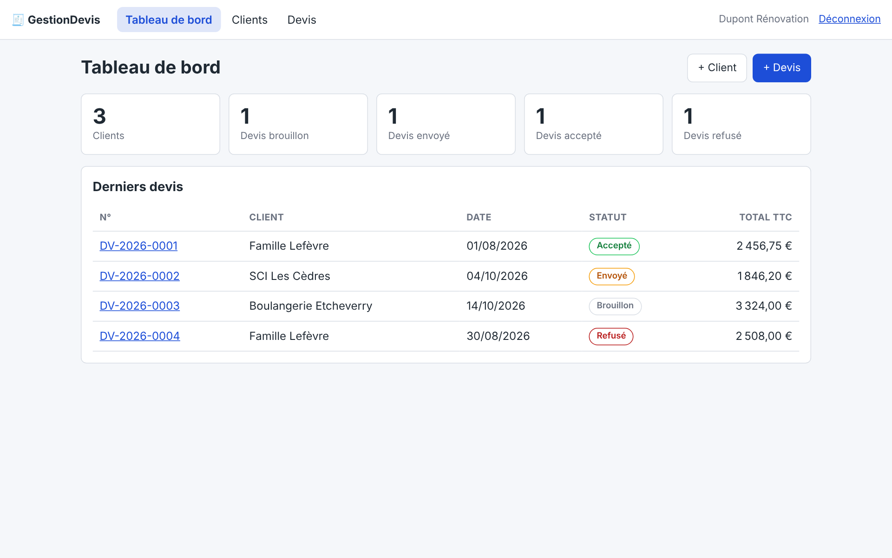
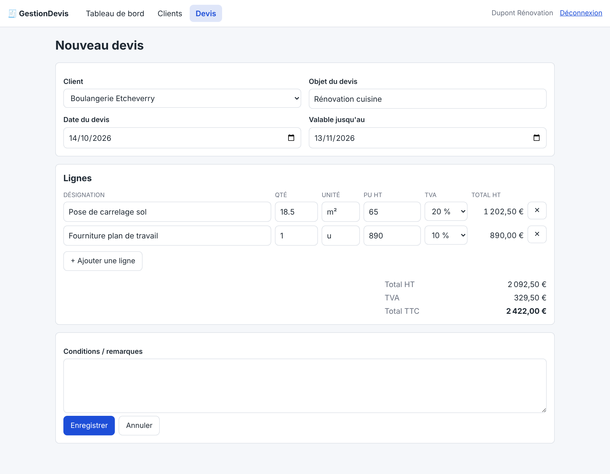
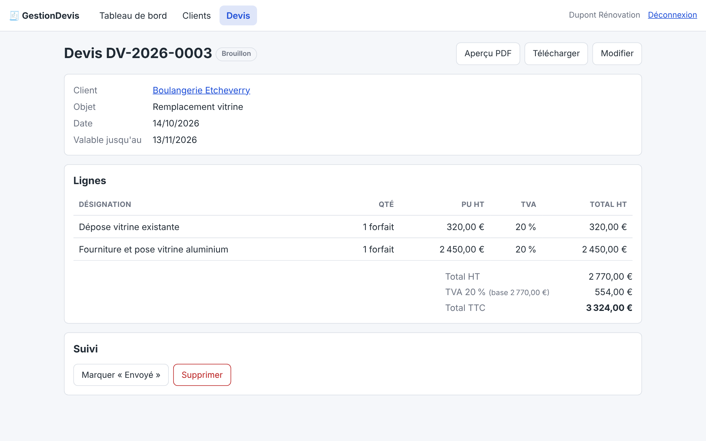

# GestionDevis

[](https://github.com/FelixAutant/GestionDevis-Client/actions/workflows/ci.yml)


[](LICENSE)
[](https://gestiondevis.onrender.com)

Application web de gestion de **clients et de devis pour artisans** : création de devis avec calcul
des montants et TVA, suivi des statuts, export PDF, comptes protégés.

Projet personnel conçu pour démontrer la livraison d'une application complète :
modélisation, sécurité, tests automatisés, intégration continue et documentation.

**Démo en ligne** : <https://gestiondevis.onrender.com> — bouton « Essayer la démo sans compte »
(ou `demo@gestiondevis.test` / `demo-password`). Hébergement gratuit : le premier chargement après
une période d'inactivité peut prendre 30 à 60 s.



| Saisie d'un devis (totaux recalculés en direct) | Détail d'un devis (TVA ventilée par taux) |
|---|---|
|  |  |

## Fonctionnalités (V1)

- **Authentification** par e-mail / mot de passe, comptes créés en console (pas d'inscription publique)
- **Permissions** : chaque artisan ne voit et ne modifie que ses propres clients et devis (voter Symfony)
- **Clients** : fiche, coordonnées, recherche, suppression bloquée s'ils ont des devis
- **Devis** : lignes multiples, quantités décimales, TVA 20 / 10 / 5,5 / 0 %, totaux HT / TVA ventilée / TTC
- **Numérotation** `DV-AAAA-NNNN`, séquentielle par artisan et par année
- **Suivi** : brouillon → envoyé → accepté / refusé ; seul un brouillon est modifiable ou supprimable
- **PDF** du devis (aperçu et téléchargement)
- **Interface responsive** ; totaux recalculés en direct dans le formulaire

## Choix techniques

| Sujet | Choix |
|---|---|
| Framework | Symfony 7.4 (LTS), PHP 8.3 |
| Base de données | PostgreSQL 16, Doctrine ORM + migrations |
| Vue | Twig, CSS maison, JS natif via AssetMapper (aucune chaîne de build Node) |
| PDF | Dompdf |
| Tests | PHPUnit 12 : unitaires + fonctionnels (WebTestCase) |
| Qualité | PHPStan niveau max (sans baseline), PHP-CS-Fixer (règles `@Symfony`) |
| CI | GitHub Actions (style, analyse statique, lint, audit des dépendances, migrations, tests) |

**Montants en entiers** : prix en centimes, quantités en centièmes, TVA en points de base. Aucun `float`
dans les calculs, donc aucune dérive d'arrondi. La TVA est calculée **une fois par taux** sur la base HT
cumulée (voir `src/Service/QuoteCalculator.php` et ses tests).

## Lancer en local

Prérequis : PHP 8.3 (`intl`, `pdo_pgsql`, `gd`, `mbstring`, `zip`), Composer, PostgreSQL 16 (ou Docker).

```bash
composer install
docker compose up -d database          # ou un PostgreSQL local ; adapter DATABASE_URL dans .env.local
php bin/console doctrine:database:create
php bin/console doctrine:migrations:migrate
php bin/console doctrine:fixtures:load  # données de démo (purge la base !)
php -S 127.0.0.1:8000 -t public public/index.php
```

> Avec le serveur intégré de PHP, le script `public/index.php` doit être passé comme routeur
> (sinon les assets `.js`/`.css` renvoient 404). `symfony server:start` n'a pas ce problème.

Compte de démo (fixtures) : `demo@gestiondevis.test` / `demo-password`.
Créer un vrai compte : `php bin/console app:user:create vous@exemple.fr "Mon entreprise"`.

## Tests

```bash
php bin/console doctrine:database:create --env=test
php bin/console doctrine:migrations:migrate --env=test --no-interaction
php bin/phpunit
```

Qualité du code (également vérifiée en CI) :

```bash
vendor/bin/php-cs-fixer check --diff   # style ; `fix` pour corriger
vendor/bin/phpstan analyse              # analyse statique, niveau max
```

## Structure

```
src/Entity/        User, Client, Quote, QuoteLine
src/Enum/          QuoteStatus (statuts et transitions autorisées)
src/Service/       QuoteCalculator, QuoteNumberGenerator, QuotePdfGenerator
src/Security/      OwnerVoter (isolation des données par artisan)
src/Controller/    Security, Dashboard, Client, Quote
tests/Unit/        calcul des montants, statuts
tests/Functional/  authentification, permissions, clients, devis, PDF
```

## Déploiement

Voir [docs/DEPLOIEMENT.md](docs/DEPLOIEMENT.md) : déploiement classique, et démo gratuite via Docker + Render + Neon.

## Pistes pour la suite

API REST (API Platform) · envoi du devis par e-mail · conversion devis → facture · remises ·
catalogue de prestations · inscription avec confirmation d'e-mail.

## Licence

[MIT](LICENSE).
